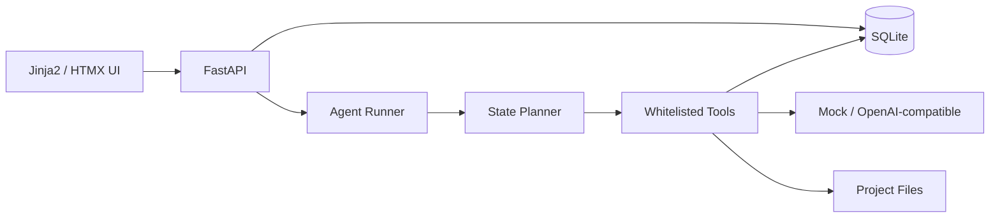

# 热点驱动宣传创作工作台

这是一个可公开部署的单 Agent 宣传创作网站。用户创建项目、上传活动资料、确认异常事实、提供参考案例并选择创作策略后，Agent 会根据数据库中的项目状态调用白名单工具，生成稿件、执行质量检查并导出 Markdown。阶段目标稳定，但执行路径会随项目状态变化；遇到异常事实或策略选择时，Agent 会暂停并等待用户操作。

默认配置使用免费的确定性 `MockAIProvider`，因此克隆后无需密钥即可跑通完整产品流程。仓库同时内置 `OpenAICompatibleProvider`；配置兼容 Chat Completions 的模型服务后，案例分析、策略、正文和质检会真正调用该服务，失败时不会静默退回 Mock。

## 本地运行

Windows 推荐只使用仓库包装脚本：

```powershell
cd D:\aipm\demo
.\scripts\setup.ps1
.\scripts\dev.ps1
```

打开 `http://127.0.0.1:8000`。首页可以新建自己的项目，也可以选择“载入示例项目”快速体验。测试命令：

```powershell
.\scripts\test.ps1 -q
.\scripts\e2e.ps1 -q
```

macOS/Linux 使用 Python 3.11 或 3.12，安装 `requirements.lock.txt`，把 `WORKBENCH_ROOT` 设置为可写目录，并让 `DATABASE_URL` 指向同一目录中的 SQLite 文件，再执行迁移与启动：

```bash
export WORKBENCH_ROOT="$PWD/.runtime"
mkdir -p "$WORKBENCH_ROOT/storage"
export DATABASE_URL="sqlite:///$WORKBENCH_ROOT/storage/app.db"
python -m alembic upgrade head
python -m uvicorn workbench.main:app --host 127.0.0.1 --port 8000 --workers 1
```

Windows 包装脚本把虚拟环境、缓存、SQLite、上传、导出、浏览器文件和测试结果全部留在 `D:\aipm\demo`。运行数据位于 `storage/`，Markdown 位于 `exports/`，测试产物位于 `test-results/`。

## 免费部署到 Render

仓库根目录的 `render.yaml` 已声明一个免费、单实例、公开访问的 Docker Web Service。

1. 把仓库推送到 GitHub。
2. 登录 Render，选择 **New → Blueprint**，连接该仓库并应用 `render.yaml`。
3. 等待构建完成，打开 Render 给出的公开 `onrender.com` 地址。该链接无需登录，任何拿到链接的人都能创建和修改项目。

默认部署不需要任何付费服务，并使用 Mock Provider。Render 免费实例使用临时文件系统，并会在连续 15 分钟无访问后休眠：休眠、重新部署或实例重启都会清空 SQLite、上传文件和导出文件；下一次访问唤醒可能需要约一分钟，回到首页即可重新创建项目或载入示例项目。这不是“只能做演示”，而是免费托管不承诺持久保存用户数据。

公开站当前采用单用户语义，没有账号隔离。多个访客可以同时打开，但会共享同一个数据库、文件空间和模型额度，也可能看到或修改彼此的项目。因此只适合面试展示和公开试用，不能上传敏感材料。

## 接入真实模型

在启动进程的环境变量或 Render 服务的 **Environment** 中设置（仓库附带的 `.env.example` 仅作为变量清单，不会被程序自动读取）：

```text
AI_PROVIDER=openai_compatible
AI_BASE_URL=https://你的兼容服务/v1
AI_API_KEY=服务端密钥
AI_MODEL=文本模型名称
AI_VISION_MODEL=可选的视觉模型名称
```

保存环境变量并重新部署后，真实 Provider 会通过现有结构化契约运行。API Key 只在服务端环境中读取，不写入页面、数据库、日志或导出文件。认证错误不重试，网络错误、429 和 5xx 最多重试一次，结构错误最多修复一次。请先确认所选服务提供 OpenAI-compatible Chat Completions 接口和足够额度；默认 Mock 路径始终免费。

## 如何提供活动热点与参考内容

系统不主动联网搜索热点，只处理用户主动提供的内容：

- “活动文件”用于上传本项目的真实活动资料，解析后形成可追溯事实卡；
- “灵感收藏”支持粘贴文章正文、填写公开网页链接，或上传 PNG/JPEG/WEBP 截图；
- 公开链接会在服务端执行内网地址拦截、重定向限制、类型检查、大小限制，并提取可读正文；
- 截图配置视觉模型时可由模型理解；未配置或识别失败时，用户可填写截图说明后继续；
- 参考案例只用于提炼表达方法，不会被当作本项目的活动事实，也不会原样进入导出稿件。

## Agent 架构

技术栈为 FastAPI + Jinja2/HTMX + SQLAlchemy/SQLite + 本地项目文件。`AgentRunner` 每轮重新读取 `ProjectSnapshot`，由状态 Planner 决定调用资料解析、事实校验、案例分析、策略规划、内容生成或质量检查工具。



Agent 单次运行最多调用 12 次工具。高置信且有来源的普通事实可自动确认；只向用户集中询问异常项。推荐策略不会自动选中，用户必须主动选择后才继续生成正文。用户能看到阶段、下一动作、工具耗时与错误码，但看不到隐藏推理或敏感原文。

## 数据与安全边界

- 参考案例与活动事实分表、分服务、分模型上下文保存。
- 图片理解不得推断人物身份；低置信度结果进入人工确认。
- 硬风险不能仅靠确认绕过；软风险必须解决或记录说明。
- 生产响应包含基础浏览器安全头，请求体总大小默认限制为 25 MiB；单文件与单项目仍执行各自限制。
- 相似表达检查是创作风险提示，不构成法律意见，最终发布责任仍由用户承担。
- 生产环境禁用开发故障注入接口；本地开发可使用 `POST /api/demo/faults` 验证恢复路径。

## Docker 单实例运行

```powershell
docker build -t publicity-workbench .
docker run --rm -p 8000:8000 -e WORKBENCH_ROOT=/data -v D:\aipm\demo\.container-data:/data publicity-workbench
```

容器会先执行 Alembic 迁移，再以一个 Uvicorn worker 启动。SQLite 方案不能横向扩容为多个实例。

完整面试流程见 [`docs/demo-script.md`](docs/demo-script.md)，自动化验收记录见 [`docs/acceptance-record.md`](docs/acceptance-record.md)。
