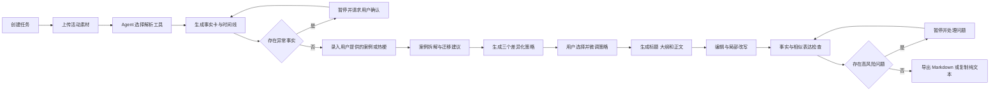
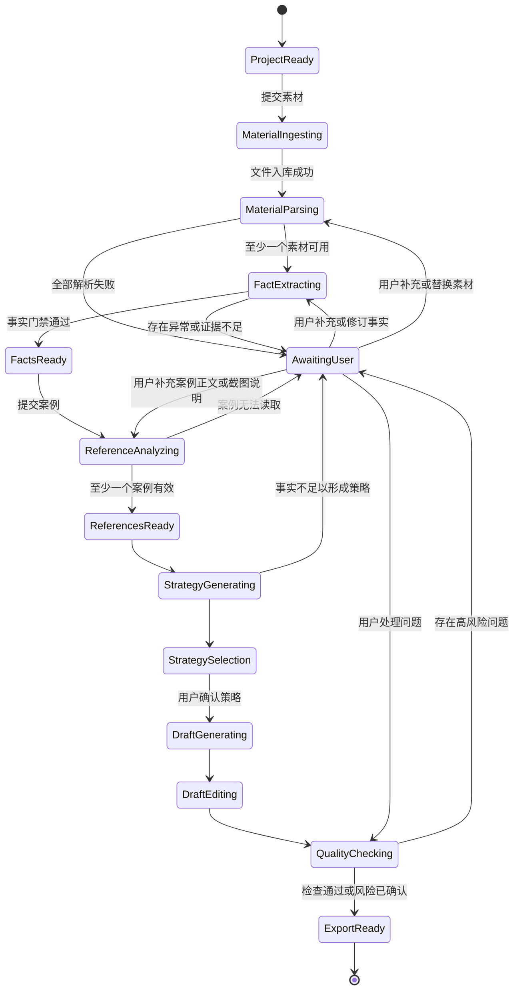
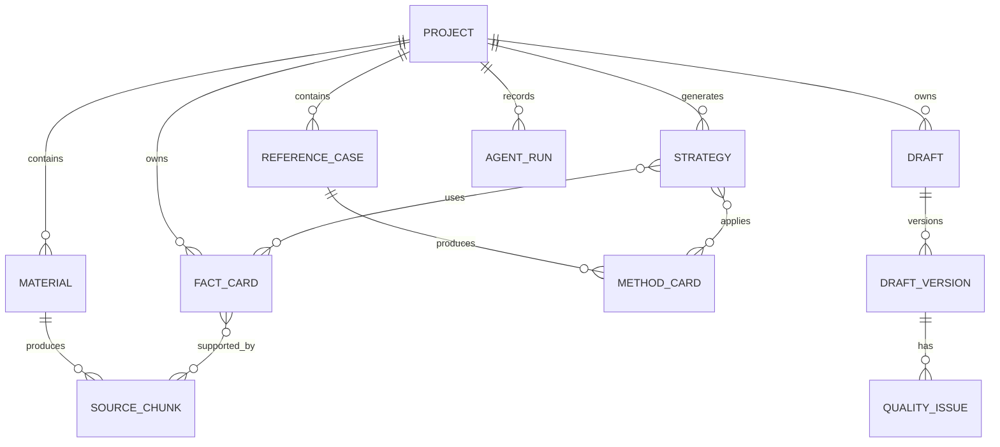
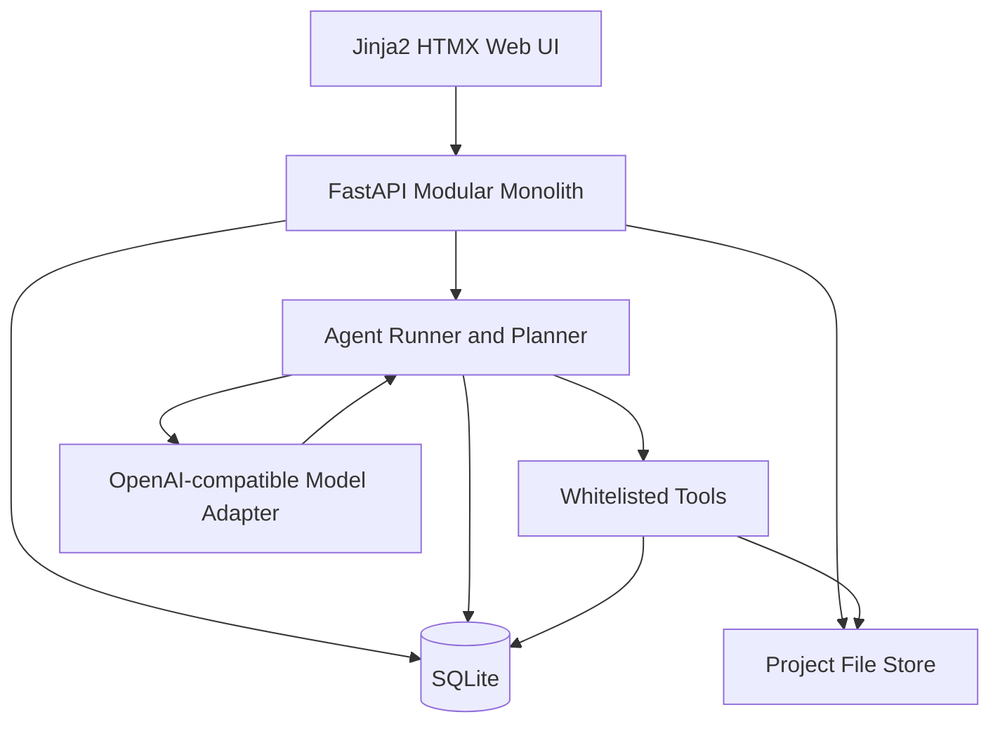

# 热点驱动宣传创作工作台产品设计文档

> 文档状态：需求确认稿  
> 目标形态：可本地运行、可通过公开链接访问并适合 GitHub 开源展示的单用户语义 Web Agent
> 设计基线：2026-11-20  
> 目标读者：产品、设计、前端、后端与 AI 应用开发者

## 1. 文档摘要

热点驱动宣传创作工作台面向支教团宣传部撰稿成员，将零散的活动文档、采访、发言稿、照片，以及用户主动提供的优秀案例或热梗，转化为可解释、可溯源且不照搬原文的长图文初稿。

产品采用“稳定主流程 + Agent 动态决策”的形态。素材输入、事实整理、案例拆解、策略选择、内容创作和质量检查构成稳定的业务骨架；Agent 在骨架内决定调用何种工具、哪些事实需要合并或标记异常、信息是否足以继续、何时暂停并向用户提问，以及质检失败后应返回哪个环节。系统通过自定义有类型的 Agent Runner、Planner、Tool Registry、结构化中间产物、条件路由、人工中断和数据库检查点体现 Agent 能力，而不是将若干次模型调用包装成固定流水线。

首版是无登录、单用户语义的桌面端 Web Agent，可在本地运行，也可作为免费 Render 单实例通过公开链接访问。系统采用 FastAPI 模块化单体，页面由 Jinja2、HTMX、少量原生 JavaScript 和 CSS 实现；Agent 编排采用自定义 Agent Runner、Planner 与白名单 Tool Registry；结构化数据存储在 SQLite，原始文件保存在实例的数据目录。模型通过 OpenAI-compatible 接口接入，密钥只从环境变量读取。产品不主动联网搜索热点，只分析用户主动提供的案例、截图、正文或链接。

## 2. 背景与机会

支教团宣传推文通常经历收到通知、现场记录、整理素材、撰稿、排版和发布。真正耗时的部分不是单次生成文字，而是从异构材料中还原事实、寻找和理解参考案例、把传播方法迁移到本次活动、反复补充上下文并校正事实。

通用聊天工具存在四个结构性问题：

1. 素材、对话和中间结论缺少项目化沉淀；
2. 活动事实与参考内容容易混入同一上下文；
3. 生成过程缺少明确的人机确认门禁；
4. 用户难以判断正文中的事实来源和方法来源。

本产品的机会是将“我觉得这篇写得不错”转化为可解释的传播方法，再将方法安全地迁移到已确认的活动事实中。

## 3. 产品定位

### 3.1 一句话定位

一个帮助支教团宣传成员整理活动事实、拆解用户提供的案例并协作生成原创长图文的可追溯 Agent 工作台。

### 3.2 目标用户

首版主要用户是负责活动长图文推文的支教团宣传部撰稿成员。他们熟悉活动本身，但素材分散、写作时间有限，也无法持续向通用模型重复补充背景。

宣传负责人是后续角色，关注事实、组织口径和风险审查，但首版不实现审批流、多用户协作或权限系统。

### 3.3 核心价值

- 将多格式活动素材整理为可回溯的事实卡和时间线；
- 将参考案例抽象为可迁移的方法，而不是复写原文；
- 在信息不足或存在冲突时主动暂停并提出高价值问题；
- 生成实质不同的创作策略并保留用户选择；
- 让正文中的关键事实能够返回具体来源；
- 在导出前发现无来源事实、冲突内容和过近表达。

## 4. 目标 非目标与反目标

### 4.1 产品目标

- 跑通从创建任务到导出 Markdown 的完整流程；
- 真实处理 DOCX、PDF、TXT、粘贴文本和常见图片；
- 使用结构化中间产物隔离事实通道与灵感通道；
- 通过条件路由、人工中断和工具选择展示真实 Agent 行为；
- 让项目能够在 GitHub 开源，可免费公开部署，并由使用者按需配置模型密钥；
- 保留清晰、稳定、可重复的面试演示路径。

### 4.2 首版非目标

- 登录注册、团队成员、审批和权限管理；
- 主动搜索全网热点、实时热榜或外部平台自动抓取；
- 公众号自动发布、多平台一键适配和复杂排版；
- 自由拖拽窗口、桌面图标或完整桌面系统模拟；
- 默认处理真实未成年人敏感素材；
- 替代人工完成最终事实核验；
- 承诺爆款、阅读量或法律意义上的不侵权。

### 4.3 反目标

即使功能能够运行，出现以下结果也视为产品失败：

- 参考案例中的人物、数字或事件进入活动事实库；
- Agent 在证据不足时自动补齐关键信息；
- 用户必须逐条确认所有正常事实，导致流程比手工整理更慢；
- 三个策略只有形容词差异，没有叙事主角、开头或结构差异；
- 复古视觉妨碍正文阅读、事实确认或主流程操作；
- 为了展示“自主性”而让 Agent 路由不可解释、不可恢复或无法稳定演示；
- 仓库包含真实 API Key、敏感原文或无法公开的数据。

## 5. 已确认的关键决策

| 决策项 | 结论 |
| --- | --- |
| 产品形态 | 可真实运行的单用户桌面端 Web Agent |
| 体验方式 | 本地页面与公开 Render 链接均可完成主流程；公开链接无需登录 |
| Agent 模式 | 稳定状态图骨架，节点内动态决策和条件路由 |
| 人工确认 | 只确认 Agent 标出的异常项，正常事实默认通过 |
| 暂停规则 | 素材不足、低置信度、事实冲突、隐私或安全风险时必须暂停 |
| 热点来源 | 只分析用户主动提供的案例与热梗，不主动搜索热点 |
| 页面结构 | 任务首页、素材库、事实确认、灵感拆解、创作策略、推文编辑器、检查与导出 |
| 技术方案 | FastAPI + Jinja2/HTMX + 自定义 Agent Runner + SQLite + 本地文件目录 |
| 模型接入 | OpenAI-compatible 抽象，通过环境变量配置 |
| 首版导出 | Markdown 下载、纯文本复制、创作说明和待确认清单 |
| 视觉方向 | 复古互联网编辑部电脑，固定窗口布局 |

### 5.1 实施边界补充

为保证 Agent 路由可重复测试，以下边界作为首版确定规则：

| 边界项 | 首版规则 |
| --- | --- |
| 案例前置条件 | 至少存在一个有效参考案例和一张有效方法卡，才能生成策略与正文；Agent 在拆解成功后自动推荐方法卡，用户可调整但无需额外确认；无案例或无有效方法卡时停留在灵感拆解并引导用户补充正文或截图 |
| 链接读取范围 | 仅尝试读取无需登录的公开 HTTP 或 HTTPS 静态页面；不携带用户 Cookie、不绕过登录或验证码、不执行浏览器自动化；拒绝本机、内网和非 HTTP 协议地址，限制重定向次数、响应大小与超时 |
| 图片证据 | 优先使用已配置的视觉模型读取图片文字和场景；未配置视觉模型或识别失败时，要求用户补充文字说明。视觉推断只能生成待确认事实或配图建议，不能单独形成默认通过的关键事实；不得从人脸推断身份；首版不强制安装本地重型 OCR |
| 运行平台 | 当前开发产物位于 Windows 的 `D:\aipm\demo`；开源代码兼容 Windows、macOS 与 Linux；生产以免费 Render Docker 单实例运行，使用临时可写目录，连续 15 分钟无访问会休眠，休眠、重启或重部署后数据清空 |
| 策略生成门禁 | 项目名称、至少两张已接受事实卡、至少一个有效参考案例和至少一张有效方法卡为最低条件；事实卡中至少一张描述活动或环节，另一张提供人物、地点、观点、引语、数字或结果等具体细节 |
| 模型能力基线 | 必须提供兼容 Chat Completions 的文本模型；原生结构化输出为优选而非强制，缺失时使用 JSON 提取、校验和一次修复；视觉模型为可选配置，未配置时图片由用户补充文字说明 |
| 标题与大纲 | Agent 随正文自动给出一个推荐标题和一份大纲，不设置额外确认门禁；用户可在 Markdown 编辑器中修改标题、大纲和正文 |
| 编辑器 | 原生 `textarea` 保存 Markdown，配少量格式按钮；不引入富文本编辑器 |
| 撤销范围 | 首版仅支持撤销最近一次 Agent 局部改写；完整版本历史与任意版本恢复留到后续 |
| 导出产物 | 下载单个 Markdown 文件，正文之后附“创作说明”和“待确认清单”；复制纯文本默认只复制正文，用户可在界面选择是否附带说明 |
| 高风险导出 | 未成年人隐私、无来源人名或精确身份、无来源引语以及与已确认事实冲突的内容必须修改或删除，不能仅确认后放行；一般相似表达和非关键低风险项可由用户确认后导出 |
| 案例原文保存 | 原始正文或截图随项目保存在本地，仅用于拆解和质检；删除案例时删除原文并使衍生方法卡失效，删除项目时一并清除 |
| 窗口控制键 | 主工作窗口支持折叠和最大化聚焦阅读；关闭只用于辅助弹窗，不删除数据或关闭主流程页面；删除始终使用独立文字按钮和二次确认 |

## 6. 方案比较与选择

### 6.1 方案 A 固定流水线

按预设顺序执行解析、抽取、拆解、生成和质检，每一步只调用固定函数。

优点是开发简单、行为稳定、容易测试。缺点是无法根据输入差异选择工具、主动补问或回退到正确阶段，面试中也容易被认为是多次模型调用的流程封装。

### 6.2 方案 B 单一自主 Agent

由一个 Agent 自主规划全部步骤、选择工具并决定何时结束。

优点是表面自主性强、实现概念简单。缺点是长链路行为不稳定、难以保证事实与灵感隔离，恢复和验收困难，也不适合涉及事实安全的人机协作场景。

### 6.3 方案 C 自定义状态式 Agent

使用自定义 Agent Runner、Planner、Tool Registry 和数据库检查点明确业务阶段、状态结构和硬门禁；Agent 根据当前项目快照选择工具和下一动作，并决定继续、暂停、重试或回退。

该方案兼顾可控性与自主性。主流程易于展示和测试，同时能明确体现 Agent 的状态、工具、记忆、规划、人工中断和恢复能力。

### 6.4 选择结论

采用方案 C。它保留状态图语义和可恢复中断，但不引入 LangGraph 依赖，更适合现有 Python 单体和开源 Demo。首版也不引入多个相互对话的 Agent，因为任务本质是一个共享项目状态上的连续决策过程，多 Agent 会增加上下文同步、成本和调试复杂度，却不会显著提升用户价值。

## 7. 核心体验原则

1. **事实与灵感隔离**：事实通道回答“发生了什么”，灵感通道回答“怎样表达更有效”，二者只在策略生成阶段通过受控结构合并。
2. **异常优先确认**：来源一致且置信度足够的事实默认通过，只把冲突、缺失、低置信度和高风险内容交给用户。
3. **每个结论可解释**：事实显示来源，方法显示案例依据，策略显示采用了哪些事实和方法。
4. **先判断再生成**：进入策略和正文前检查必要输入；缺少关键证据时提问，不编造。
5. **局部失败可继续**：单文件、单工具或单阶段失败不清空已完成结果。
6. **复古但不牺牲效率**：复古感来自窗口、标题栏、图标和色彩，而不是低可读字体或随机重叠。

## 8. 端到端用户流程



### 8.1 人工门禁

首版设置三个明确的人机协作门禁：

1. **异常与输入缺口门禁**：只在 Agent 标记冲突、低置信度、关键缺失、素材解析失败、图片需要说明、案例缺失或不可读、模型结构连续失败等异常时出现；正常事实默认通过。策略生成前的所有 `AwaitingUser` 都归入此门禁，并一次展示当前快照中的全部已知阻塞问题。
2. **策略选择门禁**：用户必须主动选择并保存一个策略，Agent 才能生成全文。
3. **导出风险门禁**：存在风险项时 Agent 必须暂停并一次列出全部问题；硬风险必须修改、删除或补充来源，软风险允许用户确认后导出。

## 9. Agent 总体设计

### 9.1 Agent 状态图



### 9.2 共享状态

Agent Runner 从数据库加载的共享项目快照至少包含：

```text
project_id
current_stage
project_brief
material_ids
parsed_material_ids
fact_card_ids
reference_case_ids
active_method_ids
strategy_ids
selected_strategy_id
draft_id
quality_report_id
pending_questions
pending_interrupt
last_error
retry_counts
checkpoint_version
```

大段原文、二进制文件和完整解析结果不直接放入图状态，只保存数据库标识和必要摘要，避免状态膨胀。

### 9.3 动态决策点

Agent 需要在以下位置作出可记录的动态决策：

- 根据 MIME、扩展名和解析探测结果选择 DOCX、PDF、文本或视觉理解工具；
- 判断多个事实是否语义相同、互补或冲突；
- 判断低置信度信息是否影响后续生成；
- 判断素材是否足以生成策略，并将当前能够发现的全部阻塞问题合并为一次提问；
- 判断案例内容是否适合支教或公益语境；
- 选择策略差异维度，并验证三个策略是否真正不同；
- 将质检问题路由到事实确认、局部重写或人工确认。

### 9.4 暂停与恢复协议

需要用户介入时，节点返回结构化中断对象：

```json
{
  "reason": "fact_conflict",
  "severity": "high",
  "summary": "两份材料对活动开始时间描述不一致",
  "questions": [
    {
      "id": "q_001",
      "question": "活动正式开始时间是 14:00 还是 14:30？",
      "affected_fact_ids": ["fact_018"],
      "source_ids": ["src_003", "src_007"]
    }
  ],
  "resume_target": "fact_extracting"
}
```

每次中断必须把当前项目快照中能够检测到的全部阻塞问题合并为一个问题组，按对后续流程的阻塞程度排序；不得为了控制数量而把已知问题留到下一轮。用户回答写入事件记录，并从检查点恢复，不重新执行已完成节点。只有用户的新回答或新素材产生了此前不可发现的新异常时，才允许再次中断。

策略生成前出现的素材解析失败、视觉说明缺失、案例缺失或不可读、事实冲突、事实不足和模型结构连续失败，都使用同一中断协议，统一归入“异常与输入缺口门禁”。策略选择和导出风险仍分别使用另外两个门禁，不额外增加第四类人工确认。

### 9.5 重试与回退

- 结构化输出校验失败：同一节点自动修复或重试 1 次；
- 模型临时失败：保留输入和已有结果，允许手动重试；
- 视觉读取低置信度或不可用：进入人工文字说明界面；
- 案例链接读取失败：回退为粘贴正文或上传截图；
- 质量检查服务失败：明确显示未完成，不显示“检查通过”；
- 节点重复失败：转为人工可编辑的结构化表单，而不是阻断整个项目。

## 10. Agent 节点与工具

| 节点 | 主要输入 | 可调用工具 | 结构化输出 | 关键路由 |
| --- | --- | --- | --- | --- |
| material_router | 文件元数据 | MIME 探测、格式解析器选择 | 解析计划 | 解析器或失败降级 |
| material_parser | 文件或文本 | DOCX、PDF、TXT、视觉模型 | 素材条目、文本块、图片描述 | 事实抽取或人工编辑 |
| fact_extractor | 素材文本块 | 模型、来源定位查询 | 事实候选、来源引用 | 合并与冲突检测 |
| fact_resolver | 事实候选 | 相似度、规则校验、模型判断 | 事实卡、异常项、时间线 | 默认通过或人工中断 |
| reference_analyzer | 用户案例 | 链接读取、视觉模型、人工说明、文本模型 | 案例摘要、方法、风险、禁用表达 | 可用或要求补充 |
| strategy_generator | 已确认事实、方法摘要 | 模型、差异度校验 | 三个策略卡 | 选择或补问 |
| draft_generator | 选定策略、事实引用 | 模型 | 标题、大纲、正文、配图建议 | 编辑器 |
| paragraph_rewriter | 选中段落、改写要求 | 模型、事实锁定校验 | 新段落、变更摘要 | 接受或撤销 |
| quality_checker | 正文、事实卡、案例 | 事实匹配、文本相似度、规则检查 | 问题清单、风险等级 | 导出或人工中断 |
| exporter | 最终稿、检查报告 | Markdown 渲染、纯文本转换 | 导出文件、创作说明 | 完成 |

### 10.1 工具接口原则

- 工具只做单一、可测试的动作；
- 工具返回结构化结果和明确错误码；
- 模型不可直接访问本地任意路径，只能通过项目级文件标识读取；
- 所有来源引用使用内部定位对象，不依赖模型自行拼接页码或段落；
- 工具调用记录名称、耗时、结果状态和错误码，不记录敏感全文到分析日志。

## 11. 结构化数据设计

### 11.1 核心实体



### 11.2 主要表

#### projects

- id
- name
- core_message
- target_audience
- target_length
- tone
- current_stage
- created_at
- updated_at

#### materials

- id
- project_id
- filename
- media_type
- material_category
- local_path
- parse_status
- parser_name
- error_code
- created_at

#### source_chunks

- id
- material_id
- text
- page_number
- paragraph_index
- bounding_box
- confidence
- content_hash

定位字段按不同格式选择性使用，不伪造不存在的页码。

#### fact_cards

- id
- project_id
- fact_type
- content
- normalized_value
- status
- confidence_level
- conflict_group_id
- user_modified
- created_at
- updated_at

事实状态包括 `accepted`、`needs_review`、`conflicted`、`source_invalid` 和 `rejected`。来源一致且置信度足够时直接进入 `accepted`。

#### fact_sources

- fact_id
- source_chunk_id
- evidence_text
- relation_type

#### reference_cases

- id
- project_id
- input_type
- source_label
- raw_content_path
- summary
- suitability
- risk_level
- status

#### method_cards

- id
- reference_case_id
- method_type
- description
- evidence_summary
- migration_advice
- prohibited_expression
- active
- recommended_by_agent

方法卡的 `active` 可由 Agent 在案例拆解成功后自动设置，用户可以调整；它不表示用户确认，也不创建额外人工门禁。策略的 `selected` 则只表示用户主动选择，两者语义不得混用。

#### strategies

- id
- project_id
- name
- narrative_angle
- protagonist
- opening_pattern
- structure_json
- fact_ids_json
- method_ids_json
- suitability_reason
- risks_json
- selected

#### drafts 与 draft_versions

草稿保存当前标题、大纲、正文、事实引用和配图建议。首版只保存最近一次 Agent 局部改写前的快照，用于单步撤销；不提供版本列表或任意历史恢复。数据结构只需避免阻碍后续增加完整版本历史。

#### quality_issues

- id
- draft_version_id
- issue_type
- severity
- message
- text_span
- related_fact_ids
- related_reference_case_id
- resolution_status
- user_acknowledged

#### agent_runs 与 agent_events

记录节点、开始与结束时间、模型配置标识、输入规模、结构校验结果、错误码、重试次数、中断和恢复事件。不得记录 API Key，也不向第三方分析平台发送敏感原文。

## 12. 模型输入输出约束

### 12.1 模型适配层

模型适配层统一接收：

- base URL；
- API Key 环境变量名；
- 模型名称；
- 超时与重试配置；
- 是否支持图像输入；
- 结构化输出能力。

业务节点不直接依赖具体供应商 SDK。仓库提供 `.env.example`，只包含变量名和示例占位符。

### 12.2 上下文最小化

- 事实抽取只读取活动素材，不读取参考案例；
- 案例拆解只读取单个案例和必要的组织语境说明，不读取活动事实全文；
- 策略生成只读取已确认事实摘要、方法卡和项目简报；
- 正文生成只读取选定策略、允许使用的事实卡和方法摘要；
- 质检阶段可读取正文、事实卡与必要案例片段，但结果只输出问题，不泄露案例原文。

### 12.3 结构化输出

所有模型节点使用 JSON Schema 或 Pydantic 模型校验。输出解析失败时，先使用同一模型执行一次格式修复；仍失败则进入人工可编辑状态。

### 12.4 不展示内部推理

界面展示来源、依据摘要、风险和 Agent 决策结果，不展示模型的隐藏推理过程。创作说明只说明采用了哪些事实、哪些方法和哪些人工选择。

## 13. 页面与交互设计

### 13.1 全局框架

桌面端基准画布为 1440 × 900 px，最低支持宽度为 1280 px。页面由顶部系统栏、左侧固定 Dock、主工作区和底部任务栏构成。

Dock 包含七个入口：

1. 我的桌面；
2. 活动文件；
3. 事实确认；
4. 灵感收藏；
5. 编辑提案；
6. 推文日志；
7. 发布检查。

未满足前置条件的页面仍可进入查看，但主操作禁用并说明缺少的条件。Agent 正在执行、等待用户或失败时，底部任务栏持续显示状态。

### 13.2 任务首页

目标是创建或恢复一个任务。

核心内容包括新建创作任务、最近任务、示例任务和项目删除。创建表单只要求活动名称，核心信息、受众、篇幅和语气可跳过。刷新页面后恢复最近一次未完成任务。

### 13.3 素材库

采用文件管理器隐喻：左侧分类树、中间素材列表、右侧解析预览。用户可上传 DOCX、PDF、TXT 和图片，也可粘贴文本。

每个素材显示排队、解析中、完成、待确认或失败状态。单个文件失败不阻塞其他文件。图片优先交给已配置的视觉模型处理；无视觉能力或识别失败时要求用户补充文字说明。图片只用于文字读取、场景理解和配图建议，不进行人脸身份推断。

### 13.4 事实确认

采用“时间线 + 事实卡 + 异常收件箱”的结构。正常事实默认通过并折叠展示；页面默认聚焦 Agent 标出的异常项。

异常项必须展示冲突内容、来源片段、影响范围和 Agent 提问。用户可以选择来源、输入正确值、补充信息或拒绝事实。处理完成后，页面显示恢复流程的明确操作。

### 13.5 灵感拆解

保留三个并排、等高窗口：案例收藏夹、AI 机制分析器和迁移备忘录。

- 左窗展示最多 3 个案例及录入方式、识别状态和是否参与策略生成；
- 中窗展示标题钩子、情绪与反差、叙事结构、人物细节和图片作用；
- 右窗展示可迁移方法、不可直接照搬的表达和语境风险。

用户可粘贴正文、上传截图或输入链接。链接读取失败时保留已填信息，并引导改用正文或截图。系统不提供自动热点推荐入口。

### 13.6 创作策略

以三封“编辑提案”并排展示三个实质不同的策略。每张策略卡包含传播角度、叙事主角、目标受众、开头方式、文章结构、拟用事实、方法来源、适配理由和风险。

系统校验三个策略至少在叙事主角、开头方式和结构中的两项不同。用户必须选择一个策略，可调整语气、篇幅和重点事实，然后进入正文生成。

### 13.7 推文编辑器

采用左侧素材抽屉、中间 Markdown 长文编辑区、右侧 AI 助手的三栏布局。标题使用独立输入框，大纲和正文保存在原生 `textarea` 中，并提供少量 Markdown 格式按钮。

首版支持：

- 1 个由 Agent 自动推荐且可编辑的标题；
- 可编辑的大纲，不设置单独确认门禁；
- 正文编辑；
- 关键事实来源链接；
- 选中段落的局部改写；
- 已确认事实锁定；
- 撤销最近一次 Agent 改写；
- 配图位置和作用建议。

局部改写必须进行事实锁定校验。若改写结果改变锁定事实，结果不得自动应用，并提示用户重试或调整要求。

撤销只针对最近一次 Agent 局部改写。若用户在该次改写后手工编辑标题、大纲或正文，撤销快照立即失效，按钮禁用，避免恢复旧快照覆盖人工内容；下一次 Agent 改写以当时的最新人工稿为新快照。

### 13.8 检查与导出

采用左侧检查类别、中间问题列表、右侧正文预览的三栏布局。检查类别包括事实来源、事实冲突、相似表达、隐私风险和配图建议。

高风险问题包括无来源的人名、身份、时间、数字或引语，以及与事实卡冲突的陈述。相似表达检查只作风险提示，不给出法律结论。

高风险问题分为可确认与不可仅确认两类：相似表达、一般语气风险和非关键事实提示允许用户查看依据后二次确认；未成年人敏感信息、联系方式、精确住址、无来源的人物身份或引语，以及仍与事实卡冲突的确定性陈述，必须修改、删除或补充有效来源，不能只勾选确认后导出。其他未确认事实如确需保留，必须在正文中改为不确定表达，并进入导出文件的待确认附录。

首版导出操作包括下载 Markdown 和复制纯文本。导出包附带创作说明与待确认清单，不包含参考案例原文、内部提示词、模型隐藏推理或系统字段。

## 14. 视觉系统

产品整体采用“2006 年编辑部电脑里运行现代 AI Agent”的视觉方向。

### 14.1 关键特征

- 浅蓝色点阵桌面背景；
- 蓝色高光窗口标题栏；
- 固定布局的复古窗口与工具栏；
- 粉色只用于主操作、当前选择和高风险提醒；
- 像素或低分辨率感图标配合清晰的现代正文字体；
- 激活和未激活窗口有明确层级，但主流程窗口不随机重叠。

### 14.2 可用性约束

- 正文不使用像素字体；
- 所有状态同时使用图标和文字；
- 颜色对比度满足 WCAG AA；
- 支持键盘焦点、合理 Tab 顺序和 `prefers-reduced-motion`；
- 1280 px 宽度保持核心三栏并排，低于 1100 px 提示使用桌面端；
- 默认关闭声音，不在首版实现声音设置。

## 15. 系统架构



### 15.1 Web 页面

- Jinja2 服务端模板 + HTMX + 少量原生 JavaScript 与 CSS；
- 负责项目导航、文件上传、事实确认、Markdown 编辑、Agent 状态和中断表单；
- 通过 1 至 2 秒轮询获取长任务状态；
- 不在浏览器中保存模型密钥；
- 不引入 Node 构建链、SPA 框架或富文本编辑器内核。

### 15.2 后端

- FastAPI 提供项目、文件、Agent 运行、人工恢复、编辑和导出接口；
- 后台任务在单进程 Demo 中可采用进程内任务队列，接口层保留替换为正式队列的边界；
- 解析器、模型适配器和业务规则通过独立服务模块组织；
- 所有文件访问限制在项目目录中。

### 15.3 存储

- SQLite 保存项目状态、结构化中间产物、检查点索引和事件；
- 本地文件系统保存上传文件、解析产物与导出文件；
- 项目删除时删除数据库记录和对应项目目录；
- 示例数据与用户数据目录分开，示例数据不得包含真实敏感信息。

### 15.4 长任务反馈

素材解析、策略生成和正文生成需要持续反馈。首版固定使用 1 至 2 秒轮询，并以数据库状态作为刷新恢复的唯一依据；任务进入完成、失败、取消或等待用户等终态后停止轮询。

事件至少包含：

```json
{
  "run_id": "run_123",
  "stage": "fact_extracting",
  "status": "running",
  "message": "正在合并来自 3 份材料的事实",
  "progress": 0.65,
  "requires_user_action": false
}
```

## 16. API 边界

首版建议接口如下：

| 方法 | 路径 | 用途 |
| --- | --- | --- |
| POST | `/api/projects` | 创建项目 |
| GET | `/api/projects` | 获取最近项目 |
| GET | `/api/projects/{id}` | 获取项目及当前阶段 |
| DELETE | `/api/projects/{id}` | 删除项目及本地文件 |
| POST | `/api/projects/{id}/materials` | 上传文件或粘贴文本 |
| GET | `/api/projects/{id}/materials` | 获取素材与解析状态 |
| POST | `/api/projects/{id}/runs/parse` | 启动素材解析和事实抽取 |
| GET | `/api/projects/{id}/facts` | 获取事实卡、时间线和异常项 |
| PATCH | `/api/projects/{id}/facts/{fact_id}` | 修订、确认或拒绝异常事实 |
| POST | `/api/projects/{id}/interrupts/{interrupt_id}/resume` | 提交回答并恢复 Agent |
| POST | `/api/projects/{id}/references` | 录入案例正文、截图或链接 |
| POST | `/api/projects/{id}/runs/analyze-references` | 启动案例拆解 |
| POST | `/api/projects/{id}/runs/generate-strategies` | 生成三个策略 |
| PATCH | `/api/projects/{id}/strategies/{strategy_id}` | 选择并微调策略 |
| POST | `/api/projects/{id}/runs/generate-draft` | 生成标题、大纲和正文 |
| POST | `/api/projects/{id}/draft/rewrite` | 局部改写并执行事实锁定检查 |
| PATCH | `/api/projects/{id}/draft` | 保存人工编辑 |
| POST | `/api/projects/{id}/runs/quality-check` | 执行导出前检查 |
| POST | `/api/projects/{id}/export` | 导出 Markdown 或纯文本 |
| GET | `/api/runs/{run_id}/events` | 获取 Agent 运行事件 |

所有写接口返回可追踪的项目版本或运行标识，避免页面刷新后丢失任务。

## 17. 文件与项目目录

仓库建议结构：

```text
project-root/
  apps/
    web/
    api/
  packages/
    agent/
    schemas/
    parsers/
  data/
    samples/
    projects/
  tests/
    unit/
    integration/
    fixtures/
  .env.example
  docker-compose.yml
  README.md
```

运行时产生的 SQLite、上传文件、解析缓存和导出文件统一放入可配置的数据目录，并加入 `.gitignore`。当前开发环境的所有产物必须位于 `D:\aipm\demo` 内；Render 使用 `/tmp/workbench`，实例重启或重部署后允许清空。

## 18. 安全与隐私

- 只使用脱敏、模拟或获得明确许可的演示素材；
- 提示用户在上传前移除未成年人姓名、联系方式、精确住址和班级等信息；
- 不通过照片识别或推测人物身份；
- API Key 仅从后端环境变量读取，不返回前端、不写日志；
- 文件名使用安全重命名，读取路径必须验证属于当前项目目录；
- 上传接口限制允许的类型、文件数和单文件大小；
- 删除项目时同步删除原始文件、解析产物和 Agent 检查点；
- 导出前扫描内部字段、提示词片段和参考原文泄漏；
- 开源前运行密钥扫描并检查示例数据授权。
- 公开站无账号隔离，所有访客共享项目、文件空间和模型额度；页面与 README 必须明确不得上传敏感资料。

## 19. 性能与可靠性目标

| 场景 | 目标 | 处理方式 |
| --- | --- | --- |
| 普通页面操作 | 1 秒内反馈 | 立即更新状态或显示骨架屏 |
| 素材解析启动 | 2 秒内显示进度 | 显示排队、解析、完成和失败 |
| 策略生成 | 目标 60 秒内完成 | 超过 15 秒显示阶段进度 |
| 正文生成 | 目标 90 秒内完成 | 分阶段显示标题、大纲和正文 |
| 单文件失败 | 不阻塞其他素材 | 支持重试、删除或替代输入 |
| 页面刷新 | 恢复当前项目 | 从数据库和检查点恢复 |

## 20. 可观测性

记录以下事件，但不把敏感全文发送到分析平台：

- 任务创建成功或失败；
- 单文件解析成功、失败、耗时和错误码；
- 事实卡生成、异常数量、人工修订和恢复；
- 案例拆解成功、风险级别和录入方式；
- 策略生成、选择和人工调整；
- 正文生成耗时、字数和事实引用数；
- 局部改写和事实锁定拦截；
- 质量检查问题数量与处理情况；
- 导出格式、是否带风险确认和总任务耗时。

面试演示页可提供一个只读的 Agent 运行轨迹面板，显示节点、工具、状态和耗时，但不展示隐藏推理或敏感输入。

## 21. 测试策略

### 21.1 单元测试

- 文件类型识别与解析器路由；
- JSON Schema 和 Pydantic 校验；
- 事实状态转换与来源失效；
- 策略差异度规则；
- 锁定事实变更检测；
- 导出内容过滤；
- 项目目录路径安全。

### 21.2 集成测试

- DOCX、PDF、TXT 和图片从上传到素材条目；
- 多来源事实合并与冲突中断；
- 中断回答后从检查点恢复；
- 案例链接失败后的输入降级；
- 选定策略到正文生成；
- 质检问题处理到 Markdown 导出；
- 更换 OpenAI-compatible 模型配置。

### 21.3 Agent 评价集

准备固定的脱敏测试包：

- 一份活动流程；
- 一份采访文本；
- 一份嘉宾发言稿；
- 约 10 张活动照片；
- 三个用户提供的参考案例；
- 一处人为设置的时间冲突；
- 一张视觉模型低置信度或需要人工补充说明的图片；
- 一段与参考案例过近的表达。

评价事实可溯源率、异常召回、策略差异度、首稿可用度和导出安全性。模型输出允许文字变化，但结构和关键业务约束必须稳定。

## 22. 验收标准

### 22.1 产品验收

- 仅填写活动名称即可创建独立项目；
- 支持上传并真实解析约定格式，单文件失败不阻塞其他素材；
- 正常事实默认通过，异常事实进入独立确认流程；
- 每个关键事实都能回到具体素材和来源片段；
- Agent 遇到素材不足或冲突时暂停，并一次提出当前能够发现的全部阻塞问题，回答前不继续执行；
- 参考案例内容不进入事实库；
- 至少一个有效案例能够生成完整方法拆解；
- 三个策略至少在叙事主角、开头或结构的两个维度存在差异；
- 用户选择策略后才能生成正文；
- 局部改写不会改变锁定事实；
- 质检能够发现无来源关键信息和测试中的过近表达；
- 最终可以下载 Markdown 或复制纯文本；
- 导出不包含参考原文、内部提示词或系统字段；
- 页面刷新后能够恢复最近任务。

### 22.2 Agent 验收

- 状态图能够从任一人工中断恢复；
- 每次节点运行有结构化输入输出和事件记录；
- 工具选择与路由结果可解释、可测试；
- 模型结构化输出失败时最多自动重试一次；
- 连续失败会转为人工可编辑状态，而不是无限循环；
- 事实与灵感上下文在数据和模型输入层均保持隔离。

### 22.3 UI 验收

- 第一眼具有复古互联网电脑桌面特征；
- 1440 × 900 首屏能够看到当前任务和主要操作；
- 1280 × 800 下核心三栏仍保持并排；
- 正文、来源和风险信息清晰可读；
- 粉色只用于关键操作、选中和风险；
- 所有状态不只依赖颜色；
- 主流程窗口不随机重叠，窗口控制键均有真实功能。

## 23. 面试演示脚本

建议将演示控制在 6 至 8 分钟：

1. 用 30 秒说明痛点：问题不是不会让模型写，而是素材、方法和事实没有形成可控工作流；
2. 上传完整示例包，展示 Agent 根据文件类型选择不同工具；
3. 展示事实卡默认通过，并由一处时间冲突触发人工中断；
4. 回答 Agent 问题并恢复状态图，强调无需重新执行已完成节点；
5. 录入用户提供的案例或热梗，展示方法拆解、禁用表达和语境风险；
6. 比较三个实质不同的策略并选择一个；
7. 生成正文，查看一个关键事实来源，并演示局部改写与事实锁定；
8. 执行导出前检查，处理过近表达后导出 Markdown；
9. 最后展示 Agent 运行轨迹和项目架构，说明工具、状态、记忆、人工门禁与恢复机制。

## 24. 开源交付要求

仓库至少提供：

- 清晰的 README 和产品截图；
- 一条最短本地启动路径；
- `.env.example` 与支持的模型配置说明；
- 脱敏示例数据和一键载入示例任务；
- 数据目录、文件上传和删除行为说明；
- Agent 状态图和架构图；
- 核心单元测试与端到端演示测试；
- 已知限制、隐私声明和不承诺事项；
- 不含密钥、真实用户文件和运行时数据库的 `.gitignore`。

如果前后端依赖较多，提供 Docker Compose 作为可选启动方式；本地开发仍应保留直接启动命令，避免把容器作为唯一体验路径。

## 25. 分阶段范围

### 25.1 首版必须完成

- 七个工作区和复古互联网视觉框架；
- 项目创建与最近任务恢复；
- 多格式素材上传与真实解析；
- 事实卡、来源、时间线和异常确认；
- 用户案例录入、方法拆解和风险提示；
- 三策略生成、选择和微调；
- 标题、大纲、正文和配图建议；
- 局部改写和事实锁定；
- 事实与相似表达检查；
- Markdown 下载和纯文本复制；
- 自定义 Agent Runner 的中断、数据库检查点和恢复；
- SQLite、本地文件存储和项目删除；
- 示例任务、测试数据和基础自动化测试。

### 25.2 后续增强

- 完整草稿版本历史与任意版本恢复；
- 富文本复制；
- 更细的图片筛选、封面和图片说明；
- 往期推文风格库与组织口径知识库；
- 团队批注、审批和权限；
- 合规数据接口支持下的热点候选推荐；
- 公众号排版模板和发布后数据回流。

## 26. 留给实现阶段的工程选择

以下选择不改变产品行为，可在开发计划阶段根据仓库现状确定：

- Markdown 工具栏的具体按钮与快捷键；
- PDF 文本提取的具体开源库；
- 视觉模型不可用时人工补充说明的具体交互；
- SQLite ORM；
- 相似表达的初始阈值和策略差异度的具体计算方式；
- 单文件大小、项目文件数和模型 token 预算的默认值。

这些工程选择必须满足本文的行为约束、隐私要求和验收标准，并在实现计划中明确。
