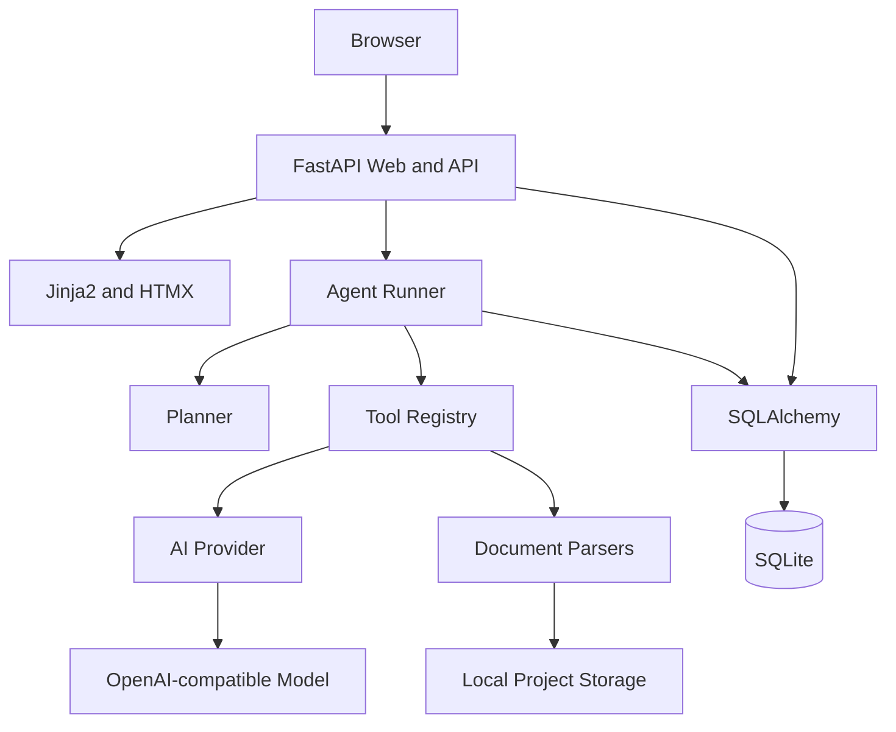

# 热点驱动宣传创作工作台技术栈建议

> 文档状态：推荐方案  
> 依据：`memory-bank/design-document.md` 与当前仓库实现  
> 核心原则：单体优先、依赖克制、状态可恢复、接口可替换、默认离线可演示

## 1. 推荐结论

本项目最合适的技术栈是 **Python 模块化单体**：

```text
Python 3.12
FastAPI + Uvicorn
Jinja2 + HTMX + Vanilla JavaScript + CSS
Pydantic 2 + pydantic-settings
SQLAlchemy 2 + Alembic + SQLite
自定义有类型的 Agent Runner + Planner + Tool Registry
HTTPX + OpenAI-compatible Provider
python-docx + pypdf + Pillow
pytest + HTTPX + Playwright
```

这个组合比 `Next.js + FastAPI + LangGraph` 更适合当前项目。现有仓库已经用一套 Python 代码实现页面、API、项目状态、Agent 运行、暂停恢复、文件处理和测试；继续沿用可以避免 Node 与 Python 两套构建链、前后端类型重复、跨进程状态同步和额外部署复杂度。

推荐保留设计文档中的“状态图编排 Agent”思想，但首版**不新增 LangGraph 依赖**。当前 `AgentRunner + Planner + ToolRegistry + 数据库检查点` 已经实现状态决策、工具调用、人工中断、幂等恢复、调用上限和事件追踪。Agent 是由决策能力、工具使用、状态和反馈闭环定义的，不由是否使用某个框架定义。

## 2. 方案比较

| 方案 | 优点 | 代价 | 结论 |
| --- | --- | --- | --- |
| Next.js + FastAPI + LangGraph | 前端生态丰富，适合复杂 SPA；LangGraph 有现成图编排抽象 | 两套语言和构建链；接口与类型重复；部署、调试和恢复链路更复杂；需要重写现有页面与 Agent | 不适合首版 |
| FastAPI + Jinja2/HTMX + 自定义 Agent Runner | 单语言、单进程、单仓库；现有实现可直接演进；服务端状态一致；测试与部署简单 | 超复杂客户端交互不如 React 灵活 | **推荐** |
| Streamlit 或 Gradio | 原型搭建最快 | 精细 UI、复杂导航、文件状态、人机中断和端到端测试受限；难以呈现复古工作台 | 不推荐 |

选择第二种方案。它不是一次性原型栈，而是适合当前单用户语义、本地与免费公开单实例 Agent 网站的正式技术方案。

## 3. 总体架构



架构保持四层：

1. **Web 与 API 层**：处理页面、HTMX 片段和 JSON API，不承载业务规则；
2. **应用服务层**：处理项目、素材、事实、策略、稿件、质检和导出；
3. **Agent 层**：读取项目快照，决定下一动作，调用白名单工具并持久化步骤；
4. **基础设施层**：数据库、文件系统、解析器、模型 Provider 和外部 HTTP。

## 4. 运行时与语言

### 4.1 Python

推荐使用 **Python 3.12**，项目元数据声明 `>=3.11,<3.13` 或锁定到团队实际验证的单一小版本。

理由：

- FastAPI、Pydantic、SQLAlchemy、文档解析和 AI SDK 都以 Python 为主要支持语言；
- Agent、解析器、模型契约和业务规则使用同一种类型系统；
- 无需 Node.js 构建链；
- 本地脚本、测试、数据库迁移和应用服务可以共享同一个虚拟环境。

不建议继续宣称支持 Python 3.9。较宽的版本范围会增加依赖解析与测试矩阵，却不会改善 Demo 体验。

### 4.2 包管理

首版保留 `venv + pip + requirements.txt`，并增加可复现的锁定文件，例如 `requirements.lock.txt`。安装和运行只通过仓库脚本完成：

```powershell
.\scripts\setup.ps1
.\scripts\dev.ps1
.\scripts\test.ps1
.\scripts\e2e.ps1
```

不同时引入 Poetry、PDM 和 Conda。以后如果需要更快的跨平台依赖解析，可以统一迁移到 `uv`，但不把迁移作为 MVP 前置条件。

## 5. Web 后端

### 5.1 FastAPI

使用 FastAPI 统一承载：

- 服务端页面路由；
- HTMX HTML 片段；
- JSON API；
- 文件上传与导出；
- 健康检查；
- Agent 启动、暂停、恢复和状态查询。

FastAPI 官方支持通过 `Jinja2Templates` 返回服务端模板，因此无需为了页面交互额外拆出 SPA。[FastAPI Templates](https://fastapi.tiangolo.com/advanced/templates/)

推荐依赖范围：

```text
fastapi>=0.115,<1
uvicorn[standard]>=0.34,<1
jinja2>=3.1,<4
python-multipart>=0.0.20,<1
```

版本范围延续当前仓库约束。具体安装版本写入锁定文件，不在源码中依赖未锁定的最新版本。

### 5.2 进程模型

本地运行使用 **单 Uvicorn 进程、单 worker**，默认只监听 `127.0.0.1:8000`；Render 容器监听平台注入的 `PORT`，仍固定为一个 worker。

SQLite、本地文件和进程内 Agent 任务在单实例中最简单可靠。不要在当前架构上直接增加多个 Uvicorn worker，否则同一任务可能被多个进程处理，进程内任务集合也无法共享。

如未来需要公网、多用户或水平扩展，再将运行队列迁移到独立 worker，并将数据库切换为 PostgreSQL。

## 6. 前端

### 6.1 Jinja2 与 HTMX

页面使用 Jinja2 服务端渲染，HTMX 负责局部请求和 HTML 片段替换，少量 Vanilla JavaScript 处理编辑器选择、自动保存和浏览器 API。

HTMX 的服务端交互模型以 HTML 片段作为响应，适合当前“服务端持有真实状态、页面局部更新”的产品。[HTMX Documentation](https://htmx.org/docs/)

将 `htmx.min.js` 固定版本后保存在 `static/vendor/`，不依赖运行时 CDN。这样离线演示不受网络影响，也满足运行资源位于项目目录的要求。

### 6.2 不使用 React 或 Next.js 的原因

- 当前页面已经由 Jinja2 模板实现，重写没有直接用户价值；
- Agent 和项目状态以服务端数据库为准，前端不需要复杂全局状态库；
- 七个工作区以表单、卡片、列表、编辑器和状态面板为主，不需要大型 SPA；
- 省去 npm、Node、前端路由、API Client 生成和双端类型维护。

如果以后出现多人实时协作、复杂拖拽排版或离线编辑，再评估 React；不要为假设中的未来需求提前引入。

### 6.3 编辑器

首版继续使用原生 `<textarea>`，保存 Markdown 大纲和正文；标题使用独立文本输入框：

- 自动保存使用 1.5 至 2 秒防抖；
- Agent 自动生成一个推荐标题和一份大纲，用户可直接编辑，不增加标题或大纲确认门禁；
- 标题、大纲和正文分别保存；
- 来源标记通过旁侧事实卡或受控标记数据呈现；
- 局部改写由用户选中段落后调用后端接口；
- 不引入富文本编辑器内核。

这与首版只导出 Markdown 和纯文本的范围一致。等富文本复制或公众号排版成为真实需求后，再引入编辑器框架。

## 7. Agent 编排

### 7.1 推荐实现

保留当前的自定义有类型 Agent 内核：

```text
ProjectSnapshot
  -> Planner.decide_next()
  -> AgentDecision
  -> ToolRegistry.get()
  -> Tool.can_run()
  -> Tool.execute()
  -> AgentStep persisted
  -> rebuild snapshot
```

| 组件 | 职责 |
| --- | --- |
| `ProjectSnapshot` | 从数据库构造当前项目的最小可决策状态 |
| `Planner` | 根据事实、案例、策略、稿件和质检状态选择下一动作 |
| `AgentDecision` | 返回调用工具、询问用户、完成或失败四种动作 |
| `ToolRegistry` | 只暴露白名单工具，避免模型获得任意代码执行能力 |
| `AgentRunner` | 执行循环、调用上限、暂停恢复、错误终止和步骤持久化 |
| `AgentStep` | 保存输入指纹、工具、状态、输出摘要、错误码和耗时 |
| `AIProvider` | 隔离模型供应商，只提供受控的结构化能力 |

### 7.2 为什么首版不增加 LangGraph

设计文档要求的是状态图语义，而不是框架本身。现有 Agent 内核已经具备：

- 显式状态与条件路由；
- 工具白名单；
- 人工中断；
- 数据库持久化；
- 重启恢复；
- 输入指纹与幂等跳过；
- 调用次数与修订次数上限；
- 可测试的确定性 Planner。

新增 LangGraph 会引入第二套检查点、状态模型和迁移语义，也会迫使现有测试重写。首版应先把真实模型 Provider、文件解析和业务质量做实。

### 7.3 不使用多 Agent

素材、事实、案例、策略和正文共享同一项目状态，用一个 Agent 调用多个专业工具更合适。多个 Agent 会增加消息协议、上下文复制、冲突处理和成本，不能为首版带来相应收益。

## 8. 模型接入

### 8.1 Provider 接口

保留自定义 `AIProvider` 接口和默认 `MockAIProvider`：

- Mock Provider 保证仓库克隆后无需密钥即可跑通演示；
- OpenAI-compatible Provider 负责真实模型调用；
- 业务层只依赖 Pydantic 输入输出，不依赖供应商 SDK；
- 模型永远不能获得数据库 Session、文件系统对象、Shell 或工具注册表。

### 8.2 HTTP 客户端

推荐使用 `httpx` 直接调用兼容 API，而不是绑定某个供应商 SDK：

```text
httpx>=0.28,<1
```

使用共享 `httpx.Client` 或 `AsyncClient`，显式设置连接、读取、写入和连接池超时。HTTPX 官方将这些超时分别建模，适合对模型调用和链接读取采用不同策略。[HTTPX Timeouts](https://www.python-httpx.org/advanced/timeouts/)

建议默认值：

| 类型 | 模型调用 | 普通链接读取 |
| --- | ---: | ---: |
| connect | 10 秒 | 5 秒 |
| read | 120 秒 | 15 秒 |
| write | 30 秒 | 15 秒 |
| pool | 10 秒 | 5 秒 |

仅对网络错误、限流和服务端临时错误重试一次；结构错误进入一次格式修复；认证错误、请求错误和内容安全错误不自动重试。

### 8.3 结构化输出

使用 Pydantic 2 模型作为唯一契约：

- 模型支持原生 JSON Schema 时直接启用；
- 不支持时要求 JSON，并在服务端提取和校验；
- 校验失败只允许一次格式修复；
- 第二次失败转为可编辑状态或明确错误，不静默回退到 Mock。

### 8.4 配置与密钥

使用 `pydantic-settings` 和 `.env`：

```text
AI_PROVIDER=mock
AI_BASE_URL=
AI_API_KEY=
AI_MODEL=
AI_VISION_MODEL=
```

密钥使用 `SecretStr`，不得进入数据库、日志、页面或异常正文。Pydantic Settings 官方支持环境变量和 dotenv 配置，适合集中管理运行参数。[Pydantic Settings](https://pydantic.dev/docs/validation/latest/concepts/pydantic_settings/)

## 9. 数据库与持久化

### 9.1 SQLite

首版使用 SQLite，适用于本地、单用户和单实例运行。通过 SQLAlchemy 访问，避免业务代码绑定 SQLite SQL。

推荐依赖：

```text
sqlalchemy>=2.0,<2.1
alembic>=1.14,<2
```

具体版本锁定后再升级。SQLAlchemy 提供正式的 SQLite 方言；SQLite 的事务行为存在特定注意点，因此所有写入应保持短事务，并通过仓储层集中管理。[SQLAlchemy SQLite](https://docs.sqlalchemy.org/en/20/dialects/sqlite.html)

Alembic 是 SQLAlchemy 生态的轻量数据库迁移工具，继续用它管理表结构，不在应用启动时临时修改表。[Alembic Documentation](https://alembic.sqlalchemy.org/en/latest/)

数据库连接时设置：

```sql
PRAGMA foreign_keys = ON;
PRAGMA journal_mode = WAL;
PRAGMA busy_timeout = 5000;
```

### 9.2 事务边界

- 一个工具步骤对应一个短事务或少量明确事务；
- 网络模型调用期间不持有数据库事务；
- 调用前保存 `PROCESSING` 步骤，调用后重新打开 Session 写入结果；
- 使用项目 revision 或乐观版本检查丢弃过期结果；
- 删除项目时先解析并验证目录，再在事务与文件清理之间记录可恢复状态。

### 9.3 升级 PostgreSQL 的条件

只有出现多用户并发写入、多 worker、多实例、远程高可用或独立任务队列时，才升级 PostgreSQL。SQLAlchemy 仓储边界应使迁移不影响 Agent 和页面层。

## 10. 后台任务与进度

首版不使用 Celery、Redis、RabbitMQ 或 Kafka。

推荐：

- `jobs` 与 `agent_runs` 表作为事实来源；
- 进程内线程执行阻塞解析或 Agent 运行；
- 启动时扫描并恢复可恢复任务；
- 页面使用 HTMX 每 1 至 2 秒轮询状态；
- 终态后停止轮询；
- 每个任务具有调用上限、超时、取消标记和错误码。

轮询比 SSE 更容易跨刷新恢复，也不需要额外连接管理。当前任务量很小，1 至 2 秒轮询足够。任务量、并发或运行时长明显增长时，再将执行器替换为独立 worker；API 和数据库状态模型保持不变。

## 11. 文件与素材处理

### 11.1 基础解析

| 文件类型 | 推荐库 | 说明 |
| --- | --- | --- |
| DOCX | `python-docx>=1.1,<2` | 提取段落、表格和基础结构 |
| PDF | `pypdf>=5.1,<6` | 提取有文本层的 PDF；扫描件进入降级路径 |
| TXT 与粘贴文本 | Python 标准库 | UTF-8 优先并处理常见编码错误 |
| 图片 | `Pillow>=11,<12` | 校验格式、尺寸、方向和安全限制 |

### 11.2 图片理解

为保持基础安装简单，图片能力通过适配器分层：

1. **基础层**：Pillow 校验格式、像素、方向与元数据；
2. **视觉模型层**：配置 `AI_VISION_MODEL` 后优先用于图片文字读取、场景摘要和配图建议；
3. **人工降级层**：未配置视觉模型、调用失败或结果置信度不足时，要求用户补充文字说明；
4. **事实门禁**：视觉推断不能单独形成默认通过的关键事实。

首版不安装 Tesseract、PaddleOCR 或其他重型本地 OCR。只有在视觉模型与人工说明无法满足真实使用需求后，才用测试数据比较中文识别率、安装体积和 Windows 部署稳定性，并将本地 OCR 作为后续可选 extra。

### 11.3 链接读取

链接读取继续使用 HTTPX，但必须单独实现安全客户端：

- 只允许 HTTP 和 HTTPS；
- DNS 解析后拒绝 loopback、link-local、私网和保留地址；
- 每次重定向重新校验目标；
- 限制响应体大小、重定向次数、Content-Type 和总耗时；
- 不携带用户 Cookie，不绕过登录和验证码。

## 12. 测试与质量

### 12.1 测试栈

```text
pytest>=8.3,<9
pytest-asyncio>=0.25,<1
httpx>=0.28,<1
playwright>=1.49,<2
```

- 单元测试：Planner、状态转换、差异度、质检、路径安全和 Pydantic Schema；
- 集成测试：仓储、迁移、工具、恢复、Provider 契约和导出；
- E2E：示例任务、冲突中断、页面刷新恢复、编辑器自动保存和最终导出；
- 固定评价夹具：模型输出允许变化，结构和业务约束必须稳定。

默认测试使用 `MockAIProvider`，真实模型测试单独标记并默认跳过，避免 CI 产生费用和不稳定结果。

### 12.2 静态质量

建议只增加 `ruff`，统一承担格式检查和常见 lint；暂不引入多套格式化与 lint 工具。Pydantic 模型、函数签名和仓储接口保持完整类型标注。

如果团队规模扩大，再增加 `mypy` 或 Pyright；MVP 不以通过最严格静态类型检查为前置条件。

## 13. 日志与可观测性

首版使用 Python 标准 `logging`，不引入独立监控平台。结构化日志至少包含：

```text
timestamp level request_id project_id run_id step_id
tool_name duration_ms status error_code
```

日志只保存摘要和标识，不记录 API Key、完整提示词、参考原文或敏感活动材料。Agent 的用户可见运行轨迹来自数据库中的 `AgentRun` 和 `AgentStep`，不是直接暴露服务器日志。

## 14. 安全基线

- 默认仅监听 `127.0.0.1`；
- API Key 仅存在于后端进程环境；
- 上传文件使用生成的内部文件名，不信任原始路径；
- 所有路径在读写和删除前执行 `resolve()` 与项目根目录包含关系校验；
- 限制文件类型、数量、大小、图片像素和解析耗时；
- 外部链接读取启用 SSRF 防护；
- 模型没有 Shell、数据库 Session 或任意文件访问能力；
- HTML 默认使用 Jinja2 转义，只有受控内容允许标记为安全；
- 用户编辑与导出内容不直接拼入脚本；
- `.env`、SQLite、上传、缓存、日志、测试结果和导出加入 `.gitignore`；
- CI 执行密钥扫描和测试。

## 15. 部署与运行

### 15.1 默认本地运行

```text
setup.ps1 -> 创建 D 盘虚拟环境并安装锁定依赖
dev.ps1   -> 运行迁移并启动单 worker Uvicorn
浏览器     -> 打开 http://127.0.0.1:8000
```

所有运行时目录通过一个 `RuntimePaths` 对象集中生成，禁止模块各自拼接路径。当前环境的虚拟环境、缓存、数据库、上传、导出和测试产物全部位于 `D:\aipm\demo` 下。

### 15.2 Docker 与免费 Render

保留单容器 Dockerfile，并通过 `render.yaml` 声明免费公开 Web Service。容器启动脚本使用平台注入的 `PORT`，先执行 Alembic 迁移，再运行一个 Uvicorn worker；`WORKBENCH_ROOT` 与 `DATABASE_URL` 指向同一运行目录。

免费 Render 不挂载持久磁盘，SQLite、上传与导出保存在 `/tmp/workbench`。实例连续 15 分钟无访问会休眠，休眠、重新部署或重启后数据清空，下一次唤醒可能需要约一分钟。公开站无登录隔离，多个访客共享同一实例、项目和模型额度，因此定位为面试展示与公开试用，不用于敏感或生产数据。

Docker 不是严格 D 盘零写入的保证路径，因为 Docker Desktop 的宿主数据位置由用户配置。严格遵守 D 盘要求时使用 PowerShell 包装脚本。

### 15.3 CI

GitHub Actions 最小流水线：

1. 在 `ubuntu-latest`、`windows-latest`、`macos-latest` 三系统矩阵中安装锁定依赖，运行路径、启动、数据库迁移、单元与集成测试；
2. 在 `ubuntu-latest` 上运行 Ruff、安装 Playwright 浏览器并执行关键 E2E；
3. 在 `ubuntu-latest` 上执行密钥扫描；
4. 三系统矩阵不得写死 `D:\aipm\demo`，该路径只用于当前 Windows 工作区；开源环境统一使用可配置数据目录和 CI 临时目录。

## 16. 推荐依赖清单

### 16.1 运行依赖

```text
fastapi>=0.115,<1
uvicorn[standard]>=0.34,<1
jinja2>=3.1,<4
pydantic>=2.10,<3
pydantic-settings>=2.7,<3
sqlalchemy>=2.0,<2.1
alembic>=1.14,<2
python-multipart>=0.0.20,<1
httpx>=0.28,<1
python-docx>=1.1,<2
pypdf>=5.1,<6
pillow>=11,<12
```

### 16.2 开发依赖

```text
pytest>=8.3,<9
pytest-asyncio>=0.25,<1
playwright>=1.49,<2
ruff
```

HTMX 使用仓库内固定版本的静态文件，不需要 npm 依赖。

## 17. 明确不采用的组件

首版不采用：

- Next.js、React 和 Node 构建链；
- LangGraph、CrewAI 或 AutoGen；
- Celery、Redis、RabbitMQ 或 Kafka；
- PostgreSQL；
- Kubernetes；
- WebSocket；
- Redux 等客户端状态库；
- 重型富文本编辑器；
- 运行时 CDN；
- 默认启用的遥测或外部日志平台。

这些组件并非不好，而是当前单用户语义、单实例 Agent 网站没有足够需求来抵消它们增加的复杂度。

## 18. 与设计文档的对齐

本技术栈与 `memory-bank/design-document.md` 的关键决策保持一致：

1. 将“React 或 Next.js”确定为 **Jinja2 + HTMX + 少量 JavaScript**；
2. 将“LangGraph 编排”确定为 **现有自定义状态 Planner 与 Agent Runner**。

产品行为不变：仍然是状态图语义的单 Agent，具备动态工具选择、人工中断、恢复、结构化输出、事实与灵感隔离、调用上限和可解释运行轨迹。变化只用于减少依赖和重写，提高演示稳定性。

只有当自定义 Runner 的状态数量、分支复杂度或跨进程恢复需求明显超出当前实现时，才重新评估 LangGraph；首版不预留双编排实现。

## 19. 最终推荐

以当前仓库为基础继续演进，不做技术栈重写：

> **FastAPI 模块化单体 + Jinja2/HTMX 服务端页面 + SQLAlchemy/SQLite 持久化 + 自定义有类型 Agent Runner + OpenAI-compatible Provider。**

这套方案的简单体现在只有一个语言、一个进程、一个数据库和一套部署脚本；健壮体现在关键状态全部持久化、工具有白名单和类型契约、任务可以恢复、模型失败有边界、核心流程可以离线测试。
